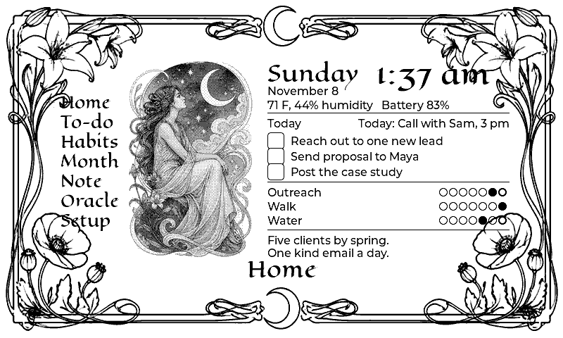
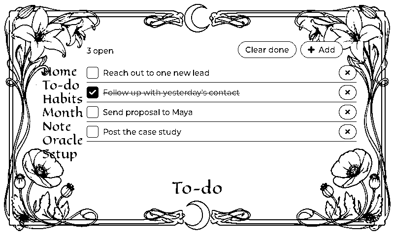
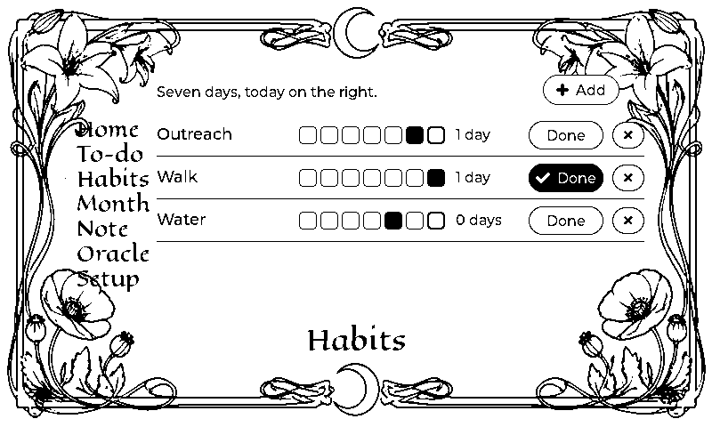
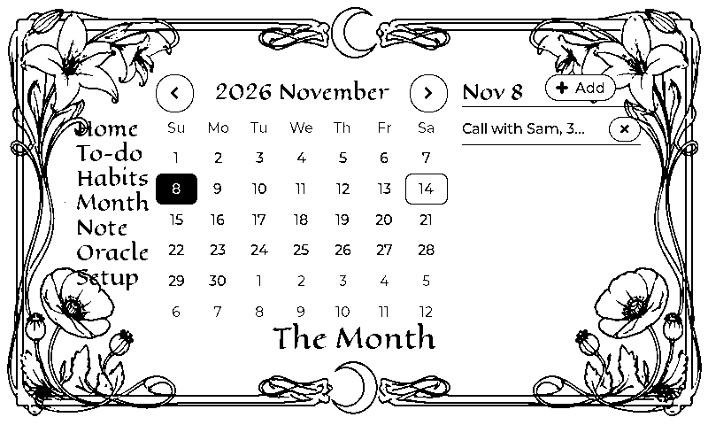
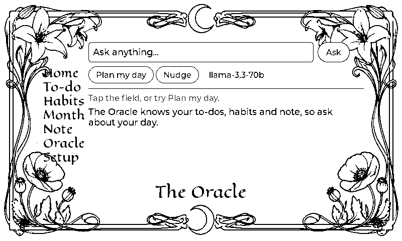
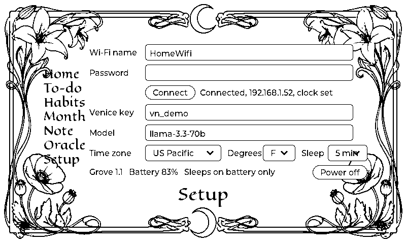
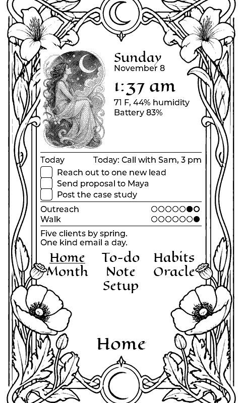
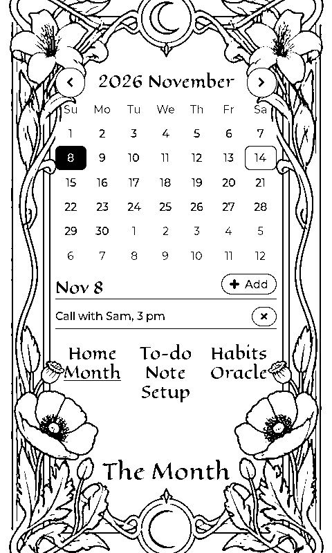
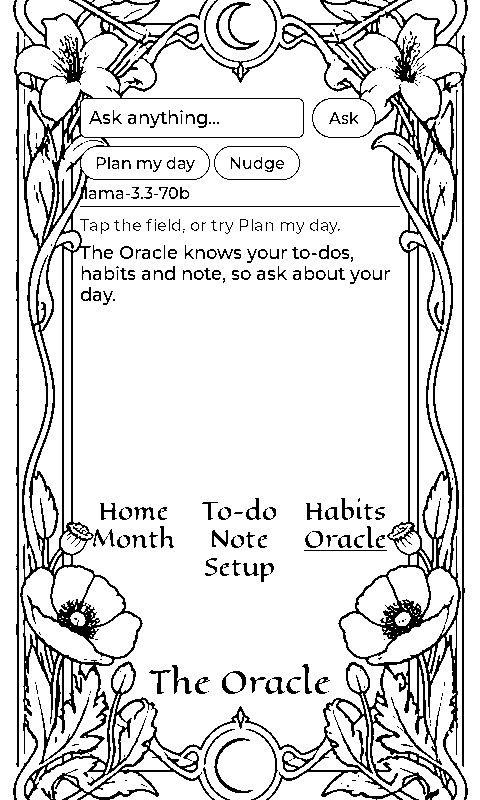

# Sticky Grove

Custom firmware for the Seeed **reTerminal Sticky** (ESP32-S3, 3.97" 800x480
four-grey e-paper, touch). A wall dashboard with to-dos, habits, a calendar,
one pinned note and a Venice AI oracle that knows your lists, drawn as an Art
Nouveau tarot card: an ornate ink frame, a Moon figure, hand-lettered titles.
It turns with the device, landscape or portrait.

| Home | To-do | Habits |
|---|---|---|
|  |  |  |

| The Month | The Oracle | Setup |
|---|---|---|
|  |  |  |

| Upright | | |
|---|---|---|
|  |  |  |

Screens above come from `tools/preview`, which renders the real UI code on a
desktop. Nothing here has run on a physical Sticky yet. See **Untested** below.

## What it does

- **Home**: weekday, date, clock, room temperature and humidity (SHT40),
  battery, the next calendar event, up to four open to-dos you can tick off,
  habit dots for the last seven days, and your pinned note.
- **To-do**: tick, add with the on-screen keyboard, delete, clear done.
- **Habits**: up to six. Seven-day strip, streak count, one Done button per day.
- **Month**: calendar with event rings and today in ink. Tap a day to add or
  remove events for it.
- **Note**: one note, shown on Home.
- **Chat**: asks Venice AI. Every request carries today's date, your open
  to-dos, habit streaks and the note, so "Plan my day" means something. Bullet
  answers can be added to the to-do list with one tap.
- **Setup**: Wi-Fi, Venice API key and model, time zone (US Pacific by
  default), degrees, sleep timer, power off. Clocks are 12-hour.
- **Orientation**: the motion sensor decides which way is up. Hang it wide or
  tall and the frame, navigation and every page re-lay themselves.

Everything is stored on the device (NVS). Nothing leaves it except the chat
request to `api.venice.ai` and the NTP time query.

## Controls

| Input | Action |
|---|---|
| Touch | Everything on screen |
| Up / Down buttons | Previous / next page (also the names in the frame) |
| Side (AI) button, short press | Jump to Chat and back |
| Side button, hold 1.5 s | Power off |
| Idle on battery | Deep sleep after the time set in Setup; Home stays on the panel. Any button wakes it |

Refresh policy: Home uses the slow four-grey refresh (about 3 s, full flash)
and only re-draws its clock every five minutes to avoid flashing on the wall.
Other pages use black-and-white refreshes: a full flash when you open a page,
quick partial updates while you work, and a cleaning flash every ten partials.

## Install on the Sticky

You need a USB-C **data** cable and desktop Chrome or Edge.

1. Download `firmware/sticky-grove-1.1.0.bin` from this repository (it is a
   merged image for flash address 0x0).
2. Open Seeed's flasher at
   <https://www.seeedstudio.com/sticky/playground/official-firmware/>.
3. Under Step 1 choose **manual upload** and pick the downloaded file. Keep
   **Standard flash** in Step 2.
4. Plug the Sticky in, click **Connect & flash**, pick the serial port
   (`usbserial` or `usbmodem` on a Mac), wait for 100%.
5. The Sticky reboots into Setup. Enter your 2.4 GHz Wi-Fi name and password,
   press Connect. Then paste a Venice API key (create one at
   <https://venice.ai>, Settings, API keys) and press the tick key.

Command-line alternative on a Mac:

```bash
pip3 install esptool
esptool.py --chip esp32s3 --port /dev/cu.usbserial-* --baud 921600 write_flash 0x0 firmware/sticky-grove-1.1.0.bin
```

**Back to stock**: the same Seeed page, Step 1 "official Sticky firmware",
Connect & flash. Voice notes and the Seedash app return. Nothing is lost
except Grove's own lists.

## Untested

This firmware was built and reviewed but not yet flashed to hardware. Two
things most likely need a one-line adjustment after the first boot:

- **Touch orientation**: if taps land mirrored or swapped, flip
  `TOUCH_SWAP_XY`, `TOUCH_MIRROR_X`, `TOUCH_MIRROR_Y` in `main/pins.h`.
- **Grey mapping on Home**: if the Moon figure looks like a negative, change
  the `level` line in `gray_to_2bpp()` in `main/display.c` to
  `s_gray8[i + k] >> 6`.
- **Which way is up**: if the screen turns the wrong way, or does not turn,
  flip `IMU_LONG_AXIS` or the sign constants at the top of `main/imu.c`. The
  log prints the raw accelerometer axes at debug level.

Serial log at 115200 baud shows what the panel, touch controller, RTC and
sensors reported at boot.

## Build from source

ESP-IDF v5.4 and the Sticky's `esp32s3` target. LVGL 9.2.2 and Espressif's
button component are fetched automatically from the component registry.
Artwork and fonts are already converted and committed; see **Artwork** to
change them.

```bash
idf.py set-target esp32s3
idf.py build
idf.py -p /dev/cu.usbserial-XXXX flash monitor
```

To refresh the merged image after a build:

```bash
esptool.py --chip esp32s3 merge_bin -o firmware/sticky-grove-1.1.0.bin \
  --flash_mode dio --flash_freq 40m --flash_size 32MB \
  0x0 build/bootloader/bootloader.bin 0x8000 build/partition_table/partition-table.bin \
  0x30000 build/sticky_grove.bin
```

### Desktop preview

Renders every page to `tools/preview/out/*.pgm` with fake data and no
hardware, using the same UI code the device runs:

```bash
cd tools/preview
cmake -B build && cmake --build build -j8 && ./build/preview
```

### Artwork

The frames, the Moon figure and the ornaments are original Art Nouveau pieces
made for this project (generated, then cut and converted), not copies of any
deck. `tools/art/img2bin.py` turns a PNG into the raw `.a8` (ink lines) or
`.l8` (four-grey picture) files under `main/assets/`, which the build embeds.
Sizes are listed once in `main/assets.h`. Titles use Eagle Lake (SIL Open Font
License) converted with `lv_font_conv --no-compress`; body text is LVGL's
Montserrat.

## Layout

```
main/
  main.c            boot order, main loop, orientation follow, idle sleep
  board.c           power latch, buttons, buzzer, battery gauge, sensor I2C bus
  display.c         SSD1677 behind an LVGL display; rotation, refresh policy
  touch.c           GT911 as an LVGL pointer, rotated to match
  imu.c             LSM6DS3 accelerometer, which way is up
  rtc_pcf8563.c     battery-backed clock
  sht40.c           temperature and humidity
  store.c           NVS blobs: to-dos, habits, events, note, settings
  net.c             Wi-Fi station, NTP, time zone
  venice.c          chat completions on a worker task
  assets.c          embedded artwork as LVGL images
  fonts/            Eagle Lake at 22, 30 and 40 px
  ui/theme.c        ink-on-paper styles and shared widgets
  ui/ui.c           frame, navigation, title plaque, keyboard, prompt, rotation
  ui/page_*.c       one file per screen, landscape and portrait layouts
components/seeed_epaper   e-paper driver (MIT, from the Sticky 2048 project)
tools/preview             desktop renderer, both orientations
tools/art                 artwork conversion
firmware/                 merged image for the browser flasher
docs/screens/             rendered screens
```

## Publishing to Seeed's Playground

Seeed lists community firmware at
<https://www.seeedstudio.com/sticky/playground/firmware/>. Once this has run
on a real device and a photo exists, submit it with the form on that page
(category: productivity, merged image at 0x0) or through the
[playground registry](https://github.com/Seeed-Projects/reterminal-sticky-playground-registry).
